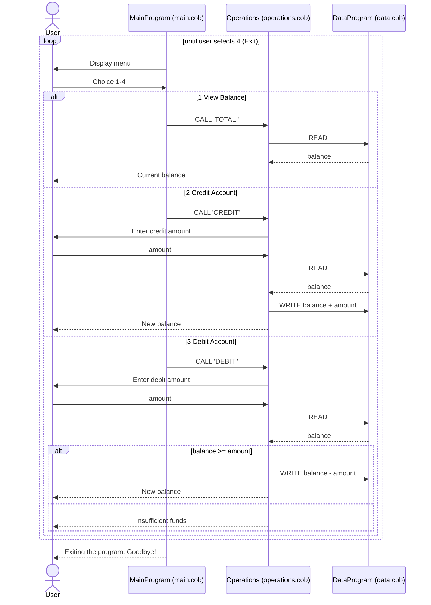

# Student Account Management System (COBOL)

A small COBOL console application that manages a single student account balance.

## Files

### `src/cobol/main.cob` (PROGRAM-ID `MainProgram`)
Entry point. Displays a menu in a loop until the user exits:
1. View Balance -> `CALL 'Operations' USING 'TOTAL '`
2. Credit Account -> `CALL 'Operations' USING 'CREDIT'`
3. Debit Account -> `CALL 'Operations' USING 'DEBIT '`
4. Exit -> sets `CONTINUE-FLAG` to `NO`

Invalid choices print `Invalid choice, please select 1-4.`

### `src/cobol/operations.cob` (PROGRAM-ID `Operations`)
Business logic for each operation:
- **TOTAL**: reads the balance from `DataProgram` and displays it.
- **CREDIT**: accepts an amount, reads the balance, adds the amount, writes it back, displays the new balance.
- **DEBIT**: accepts an amount, reads the balance; if funds are sufficient subtracts and writes back, otherwise displays `Insufficient funds for this debit.`

### `src/cobol/data.cob` (PROGRAM-ID `DataProgram`)
Persistence layer. Holds `STORAGE-BALANCE` (initially `1000.00`) in working storage and supports:
- `READ`: copies the stored balance to the caller.
- `WRITE`: stores the balance passed by the caller.

## Business rules (student accounts)
- Initial balance is **1000.00**.
- Amounts and balances are `PIC 9(6)V99`: unsigned, max 999999.99, two decimals.
- A debit is rejected if it exceeds the current balance (balance can never go negative).
- The balance only lives in memory for the program's lifetime (no file/database persistence).

## Data flow

